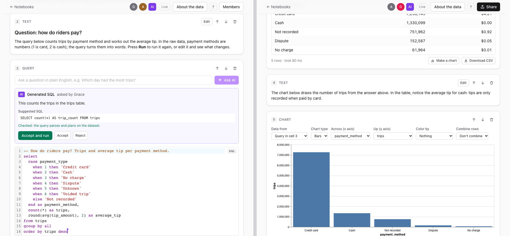
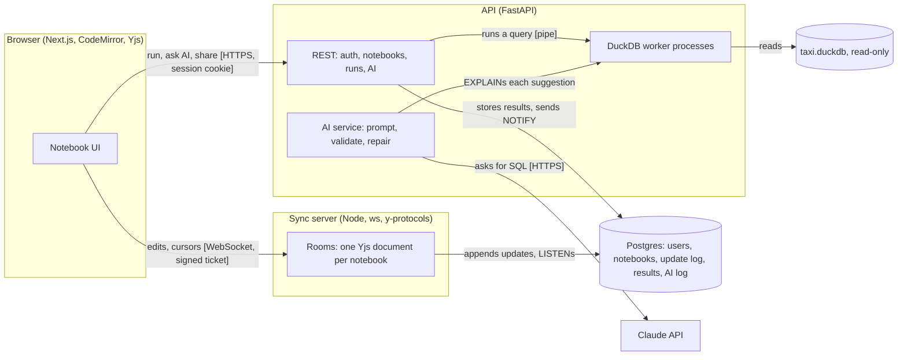

# Taxi Notebook

**A collaborative SQL notebook over NYC taxi trips, with an AI assistant that joins the session as a collaborator: several people edit the same cells live, see each other's cursors, share query results, and accept or reject the AI's suggestions.**

[Quickstart](#quickstart) · [Architecture](#architecture) · [Results](#results) · [Design decisions](docs/design.md) · [Limitations](#known-limitations)



<sub>Grace (left) asked the AI a question; Ada (right) sees the same notebook live. Captured from the end-to-end test stack, where the AI is a canned stand-in model that answers an ordinary question with the same fixed query. Here Grace asked how many trips there are.</sub>

> [!WARNING]
> Local only for now. Deployment (Vercel and Fly.io) is planned but not done; everything below runs on your machine.

## What's in it

- **Live collaboration.** Yjs documents synced through our own WebSocket server: concurrent edits to the same cell, cursors and presence, viewer and editor share links, offline editing that merges on reconnect.
- **Shared, safe query execution.** DuckDB over 9.5 million trips (January to March 2024), run in killable worker processes. One execution per cell, whoever presses Run; everyone sees the same result.
- **An AI collaborator.** Ask in plain English and Claude writes the SQL. Each query is validated (parse, then EXPLAIN) and repaired on error before it's suggested. Suggestions appear for everyone with the AI's own name and cursor, and are never applied silently.
- **Built for people who don't write SQL.** A guided example, plain-language errors with "Fix with AI", a data guide, readable results, one-click charts and CSV export.
- **Measured, not claimed.** A convergence fuzz test, a keystroke-to-render latency benchmark, a load test and a text-to-SQL eval. Each one is a script in this repo.

## Results

Each number is reproduced by the command next to it, and each run records its machine, commit and parameters. Numbers that haven't been measured say so.

| What | Result | Reproduce |
|---|---|---|
| Convergence under random concurrency | **0 divergences among editors** in 50 seeds × 4,000 random edits. Each seed had 4 editors and 1 viewer, 176–225 connects, 1 unload, 1 crash and 1 restart. In 2 of the 50 seeds the viewer kept run or AI state the crash lost (a known limitation, below). | `FUZZ_VERBOSE=1 FUZZ_SEED=1000 FUZZ_RUNS=50 pnpm --filter sync test fuzz` |
| Keystroke to remote render, 2 browsers | **p50 3.6–3.8 ms, p95 5.0–5.4 ms** (range over 3 runs of 100 keystrokes each) | `pnpm bench:latency`, run 3 times |
| The same, with 20 more editors typing | p50 1.4–1.6 ms, p95 2.6–4.0 ms | the same runs |
| Editors in one notebook with p95 under 100 ms | **At least 50** (p95 4.0–5.2 ms at 50). At 100, p95 was 8,358–22,412 ms and the result is marked inconclusive: the load generator also fell behind, while the sync server used 95–99% of one core in the 2 runs where its CPU was measured. | `pnpm bench:load`, run 3 times |
| Text-to-SQL, BIRD dev (500 questions) | Execution accuracy **Haiku 5.5 49.0%, Sonnet 5.5 52.4%, Opus 5.5 70.0%** | see below |
| Text-to-SQL, 50 taxi questions | Not measured yet | see below |

The benchmarks ran on one Apple M4 laptop (10 cores, 16 GiB, macOS), clean commit `4aa2756`, 2026-11-14 UTC, with every client and server on that machine. They are this machine's numbers, not a server's.

<details>
<summary>Benchmark details</summary>

- **Latency** (`apps/bench/src/latency.ts`): two headless Chromium processes. The time runs from the keydown on one page to the first DOM mutation showing the character on the other, so it covers CodeMirror, Yjs, the provider, the sync server and the other page's editor. It doesn't include the paint after that, or real network distance. Both pages' clocks are corrected against one reference by round trips (correction at most 0.17 ms, with ±0.26 ms or less left over). Percentiles are nearest-rank over 100 keystrokes after 20 warm-up keystrokes, typed at 5 per second. In all 3 runs, latency was lower with the 20 extra editors than without them. We haven't investigated why.
- **Load** (`apps/bench/src/load.ts`): headless Yjs clients over real WebSockets. They aren't browsers. Steps of 2, 5, 10, 25, 50 and 100 editors, each typing 5 keystrokes per second in its own cell, measured for 20 s after a 5 s warm-up. Latency is from edit to applied on up to 8 observing clients on their own threads, with missing deliveries counted as infinitely late (there were none). p95 at each step, as the range over 3 runs: 1.8–1.9, 1.5–1.6, 1.7–2.0, 3.5–4.3, 4.0–5.2 ms. At 100 editors the clients sent 33,580–42,152 messages per second to the server, because every client re-sends each cursor change it receives (y-websocket does this, and so does the browser), so traffic grows with the square of the editors.
- Raw samples, summaries and reports for each run are written to `data/bench-results/`. They aren't in git; rerun the commands to regenerate them.

</details>

<details>
<summary>Text-to-SQL eval details</summary>

- **BIRD dev:** 500 of the 1,534 questions, sampled by difficulty with seed 20261113. Every model got the same questions, with BIRD's evidence hints, effort `medium` and no model fallback.
- **Scoring:** execution accuracy as BIRD scores it (result rows equal as sets), with 95% Wilson intervals: Haiku 44.6–53.4%, Sonnet 48.0–56.7%, Opus 65.8–73.9%. Haiku and Sonnet aren't distinguishable at this size; Opus is clearly ahead.
- **Repair loop:** every first answer was valid SQL, so the validate-and-repair loop never ran, and accuracy with and without repair is identical. This run can't show whether repair helps.
- **Cost:** $4.65 in total, computed from list prices including prompt caching. That's not a bill.
- **Run details:** commit `a588d71`, 2026-11-13.
- **Rerun** (paid; it asks for `--allow-spend`):
  ```
  pnpm eval -- run --suite bird --size 500 --models claude-haiku-5-5,claude-sonnet-5-5,claude-opus-5-5 --allow-spend
  ```
  `pnpm eval -- report --run-id <id>` rebuilds a report from its stored answers for free.
- **Taxi suite:** 50 questions in `services/api/evals/taxi_questions.toml`, written by Codex (an OpenAI model) and checked by an independent review. Not run yet:
  ```
  pnpm eval -- run --suite taxi --models claude-haiku-5-5,claude-sonnet-5-5,claude-opus-5-5 --allow-spend
  ```

</details>

## Quickstart

**You need:** Node 26 and pnpm 10.34.9 (`corepack enable`), Python 3.14 with [uv](https://docs.astral.sh/uv/), and Docker (for Postgres). Disk: the taxi downloads are 160.4 MB and the database built from them is 239.1 MB. Both are kept in `data/`. The BIRD files the eval downloads take another 1,840.3 MB. These are byte counts of the files on 2026-11-14 UTC.

```sh
git clone https://github.com/KaavinB/collab-sql-notebook.git && cd collab-sql-notebook
cp .env.example .env
# Fill AUTH_SECRET and SYNC_TICKET_SECRET with two different values from:
openssl rand -hex 32
pnpm install && (cd services/api && uv sync)
docker compose up -d --wait # Postgres, ready
pnpm db:migrate             # create the tables
pnpm ingest                 # download the pinned TLC files (checksum-verified) and build data/taxi.duckdb
```

Then start the three servers, one per terminal:

```sh
pnpm dev:api     # FastAPI on :8010
pnpm dev:sync    # sync server on :8020
pnpm dev:web     # http://localhost:3000
```

Open http://localhost:3000 and sign in by typing a name (local dev sign-in; GitHub and Google OAuth need apps registered, see `.env.example`). Choose **Start with an example**. To see collaboration, open a private window, sign in as someone else, and share the notebook with them.

**Without an Anthropic API key,** everything works except the AI assistant. To try the AI flow with no key, set `AI_FAKE_MODEL=true` in `.env` for canned answers. With a key, `AI_MODEL` picks the model (default `claude-haiku-5-5`).

## Architecture



- **Web** (`apps/web`): Next.js with CodeMirror 6 bound to Yjs. It talks to the sync server for the document and to the API for everything else.
- **Sync server** (`apps/sync`): our own WebSocket server on the standard y-protocols. It checks a signed ticket and membership on connect, drops viewers' edits, persists an update log with compaction, and writes run and AI state into documents when the API announces them.
- **API** (`services/api`): FastAPI for sign-in, notebooks, sharing, query runs and the AI. Queries run in a pool of DuckDB worker processes with timeouts, row and memory caps, and a hard kill.
- **AI service** (`services/api/src/notebook_api/ai`): builds the prompt from the schema with sample values, calls Claude, validates each query with EXPLAIN on a worker, repairs up to twice, and logs every request.

**A keystroke:** CodeMirror edits the cell's Y.Text, y-websocket sends the update, the sync server relays it to everyone else in the room and appends it to Postgres, and each browser's binding renders it.

**A run:** the browser asks the API to run a cell. The API claims the cell's lock, runs the SQL on a worker, stores the result in Postgres and sends NOTIFY. The sync server writes the new run into the document, and every open browser fetches and shows the result.

The reasoning behind each choice, and what it costs, is in [docs/design.md](docs/design.md).

## Testing

| Command | What it proves |
|---|---|
| `pnpm check` | Lint, type checks, and every unit and integration test (web, sync, bench, API) |
| `pnpm e2e` | Real browsers against the real stack: editing together, runs, the AI flow (fake model), sharing, offline editing. Needs `pnpm --filter web exec playwright install chromium` once. |
| `pnpm test:api:linux` | The API tests on Linux, including the OS memory limit on query workers |
| `FUZZ_RUNS=40 pnpm --filter sync test fuzz` | The convergence fuzz at more seeds (the default runs seeds 1–4 in `pnpm check`) |
| `pnpm bench:latency`, `pnpm bench:load` | The benchmarks above (latency needs the same Chromium) |
| `pnpm eval -- run --dry-run --limit 5` | The eval harness end to end with a fake model, nothing spent (it downloads BIRD dev first) |

The fuzz test's invariant: after any mix of concurrent edits, delivery orders, drops, offline edits, reconnects, store failures, an unload, a crash and a restart, every editor, the server's copy and a fresh load from Postgres are identical, and no viewer's edit appears anywhere. CI (GitHub Actions) runs `pnpm check` and `pnpm e2e` on every push and pull request to `main`.

## Known limitations

- **Not deployed.** Running on separate web and API domains will need both under one registrable domain for sign-in cookies to work.
- **One process each** for the sync server and the API's in-memory rate limits; scaling out needs routing by notebook.
- **No OS sandbox** for query workers: safety is DuckDB's lockdown, a block list and process limits, tested against an attack corpus. On macOS, memory bombs are stopped by the timeout kill only.
- **A crash inside the 250 ms save window** can lose server-written run or AI state for viewers until they reload, and confirmed edits that weren't saved yet.
- **The sync ticket rides in the WebSocket URL** (reusable for 60 s), and signing out doesn't close live sockets yet.
- **The AI log keeps each notebook's 500 most recent requests,** not every request ever made.
- **Presence traffic grows with the square of the editors:** every y-websocket client, the browser's included, re-sends each cursor change it receives. At 100 editors the sync server used 95–99% of one core (in the 2 of 3 runs that measured it); how much of that is presence traffic hasn't been measured separately.

More, with the trade-offs, in [docs/design.md](docs/design.md#known-limitations).

## Project structure

```
apps/web/        Next.js notebook (CodeMirror, Yjs, charts)
apps/sync/       WebSocket sync server and the convergence fuzz test
apps/bench/      latency benchmark and load test
services/api/    FastAPI: auth, notebooks, query workers, AI, eval harness
  evals/         the 50 taxi questions
data/            taxi.duckdb, BIRD, eval and benchmark results (not in git)
docs/            design decisions, images
```

## Data and credits

- Trip data: [NYC Taxi and Limousine Commission trip records](https://www.nyc.gov/site/tlc/about/tlc-trip-record-data.page), yellow taxis, January to March 2024, plus the taxi zone lookup. Files are pinned by SHA-256 in `services/api/src/notebook_api/dataset/manifest.py`.
- Text-to-SQL benchmark: [BIRD](https://bird-bench.github.io/) dev set (Li et al., 2023), downloaded and checksum-verified by the eval harness.
- The 50 taxi questions were written by Codex (an OpenAI model) at the project owner's request, so the Claude models aren't scored on questions Claude wrote.

No license has been chosen yet, so all rights are reserved by default.
