<div align="center">


# Taxi Notebook

**Ask questions about New York taxi trips in plain English, together, and get answers as tables and charts.**

</div>

Taxi Notebook is a shared notebook over 9,554,757 New York yellow taxi trips from January to March 2024. You type a question like "How do riders pay: card or cash?". An AI assistant (Claude) writes the database query, checks it against the data and shows it to you. Accept it and the answer appears as a table you can turn into a chart. Several people can work in the same notebook at once, like a shared document: everyone sees each other's cursors, edits, results and the AI's suggestions live. It's for people who want answers from the data without writing SQL, and for people who do write SQL and want to work on it together.

In testing, a keystroke showed up in the other person's browser page in a median of **3.6–3.8 ms** (two browsers on one machine, timed before the screen repaints). Across 50 random runs of 4,000 concurrent edits each, with dropped connections, offline edits and a server crash, **every editor always ended up with the same notebook**. On 50 questions about this dataset, all three Claude models wrote queries that **returned the same rows as the reference query on all 50**.

**Status:** a portfolio project that runs on your machine. It is tested on macOS and, in CI, on Linux, but benchmarked only on one laptop. It isn't deployed anywhere yet.


<sub>Grace (left) asked the AI a question. Ada (right) sees the same notebook live. All screenshots in this README come from the end-to-end test stack, where the AI is a canned stand-in model that answers every ordinary question with the same query, so they cost nothing to make.</sub>

**Contents:**
[TL;DR](#tldr) ·
[See it in action](#see-it-in-action) ·
[Quick start](#quick-start) ·
[Installation](#installation) ·
[Usage](#usage) ·
[Configuration](#configuration) ·
[How the AI models compare](#how-the-ai-models-compare) ·
[How it works](#how-it-works) ·
[Results](#results) ·
[Testing and operations](#testing-and-operations) ·
[Troubleshooting](#troubleshooting) ·
[FAQ](#faq) ·
[Limitations](#limitations) ·
[Contributing](#contributing-and-support) ·
[License](#license)

## TL;DR

**The problem.** Public datasets like New York's taxi trips can answer many everyday questions: when people tip most, which neighbourhoods are busiest, how people pay. But getting those answers means writing SQL, which most people can't. Teams that can write it usually do so alone, then paste screenshots of results into chat.

**The solution.** A notebook where you ask in plain English, and an AI collaborator writes the query, checks it against the real data and shows it to everyone before anything runs. Results, charts and suggestions are shared live, so a group can explore the data together, and nobody's work is changed without them seeing it.

**Why use Taxi Notebook?**

| Feature | What it means for you |
|---|---|
| **Plain-English questions** | Type a question, click **Accept and run**, get an answer. The AI explains each query in a sentence, and checks that the database accepts it before you see it |
| **Live collaboration** | Several people edit the same notebook at once, with each other's cursors and names. Share it with a link that lets people view or edit |
| **The AI is a visible collaborator** | Its suggestions appear for everyone, with its own name and cursor. Nothing it writes is applied until a person accepts it |
| **Answers people can read** | Dates, thousands separators and dollar amounts are formatted. One click makes a chart; another downloads a CSV |
| **Errors in plain words** | A failed query says what went wrong ("There's no column called …"), suggests the closest column names, and offers **Fix with AI** |
| **Safe to share** | Queries are read-only, can't touch files or the network, and are stopped after 10 seconds. Tested against 157 adversarial queries |
| **Works offline** | Keep editing when the connection drops. Your edits merge with everyone else's when it's back |
| **Measured, not claimed** | A convergence fuzz test, a latency benchmark, a load test and a text-to-SQL evaluation, each a script you can rerun |

## See it in action

### Start from an example or a question

Signing in for the first time shows what the app does and offers a guided example notebook. It contains a question, the query that answers it, the result and a chart.

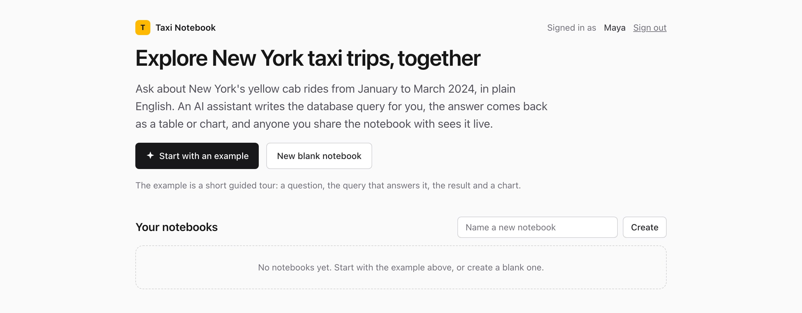

A new notebook doesn't start blank. It asks for a question and offers a few to click.

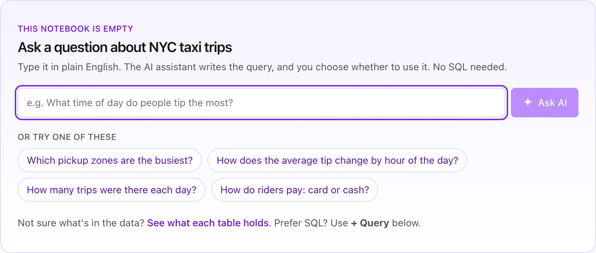

### Ask in plain English, then accept and run

The AI's suggestion arrives with a one-sentence explanation and a note that the query was checked against the dataset. **Accept and run** puts the query in the cell and runs it. **Accept** only puts it in, and **Reject** discards it. Everyone in the notebook sees the suggestion, and who asked for it.

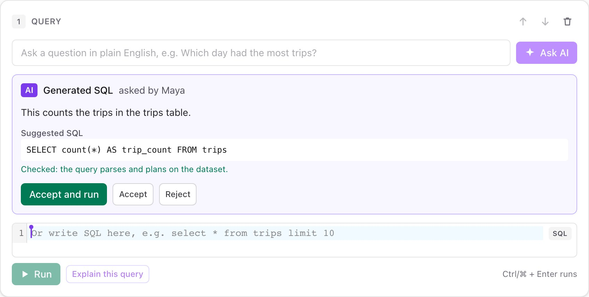

### Results people can read, and a chart in one click

People who write SQL can type it straight into the cell. Results show dates as dates, counts with thousands separators and money as dollars. The summary says how many rows came back and how long the query took.

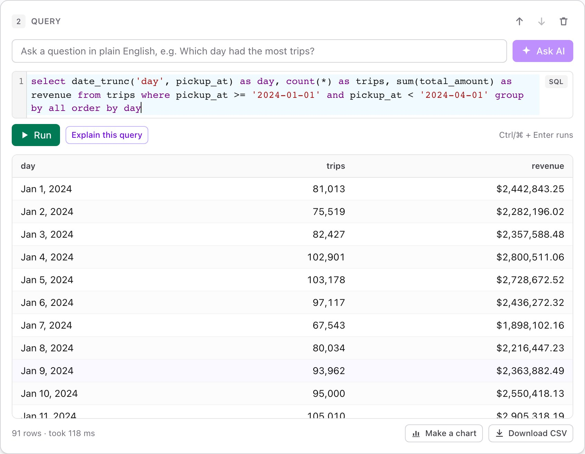

**Make a chart** picks sensible defaults from the result's columns: here, a line of trips per day across the quarter.

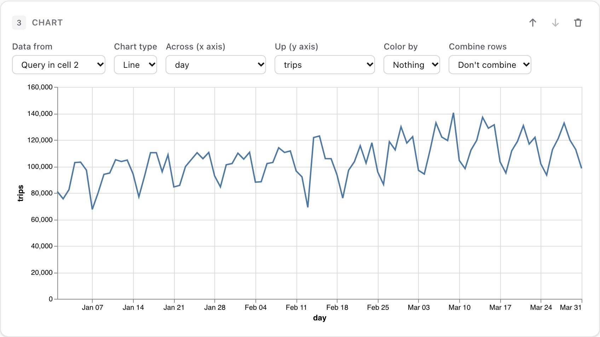

### Errors in plain words, with a fix

A query that fails says why in plain words and suggests the nearest column names. The database's own message is under **Details**. **Fix with AI** asks the AI for a corrected query, shown as a suggestion like any other.

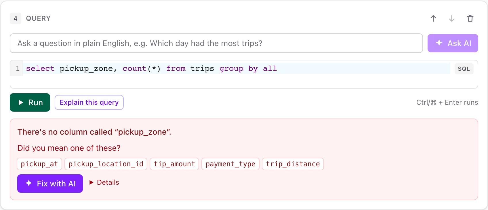

### What's in the data

**About the data** explains every table and column in plain words, with the date range. Its example questions add a cell and ask the AI.

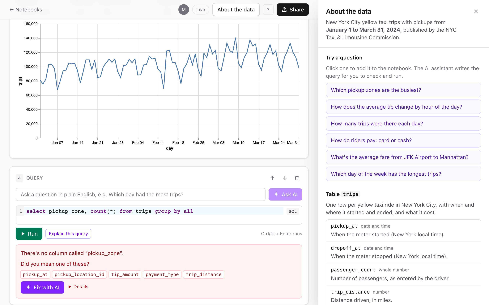

### Share it, and work on it together

**Share** creates a link that lets anyone who signs in view or edit, and lists who has access. A link can be revoked.

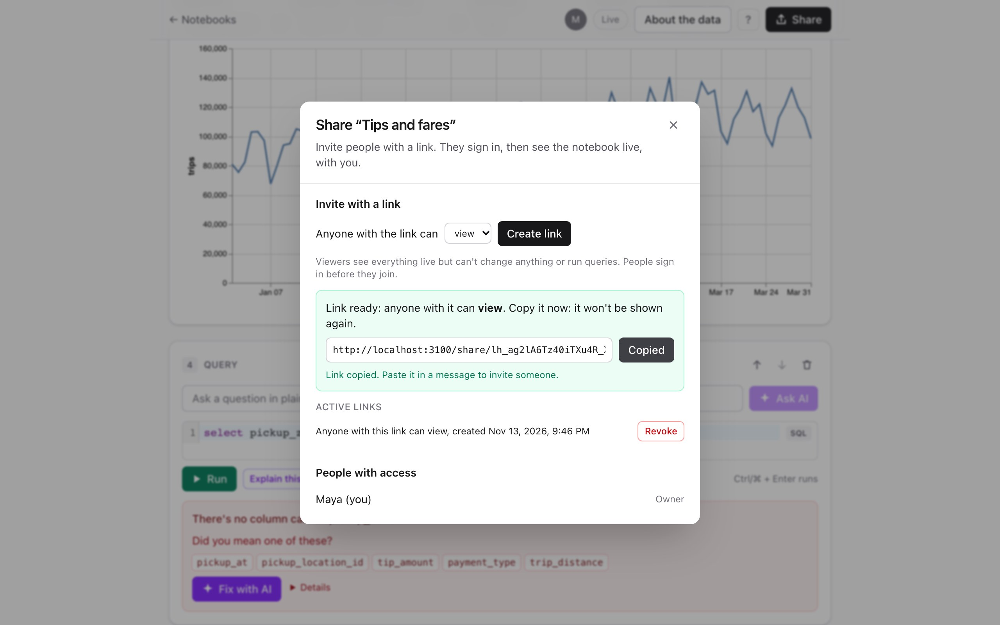

Someone who joins through a view link sees everything live but can't change anything, and is told so.

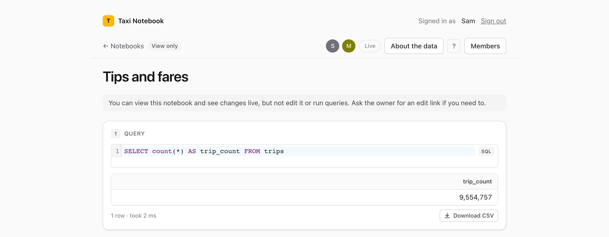

### Keep working offline

When the connection drops, the status changes to **Offline**, editing keeps working and a banner says the edits are waiting. They merge with everyone else's when the connection is back.

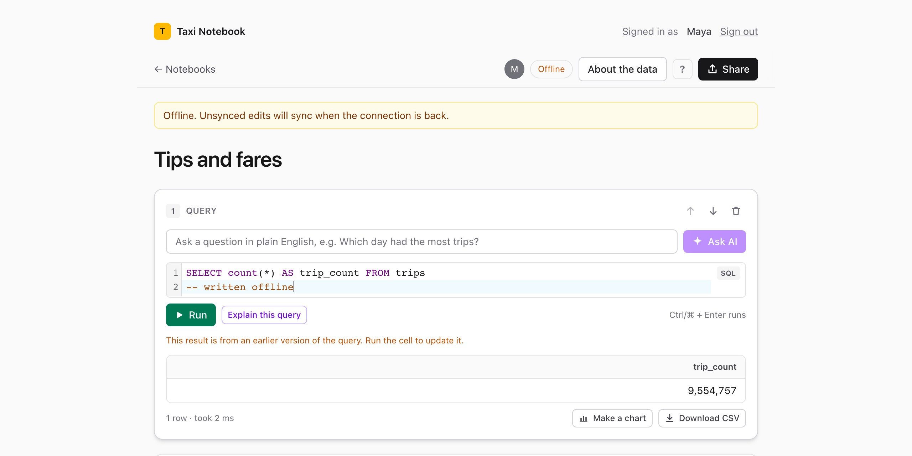

## Quick start

**Prerequisites:** Node 26 and pnpm 10.34.9 (`corepack enable` sets up pnpm), Python 3.14 with [uv](https://docs.astral.sh/uv/), and [Docker](https://docs.docker.com/get-docker/) for Postgres. No Anthropic API key is needed to try it: the steps below turn on the canned stand-in model, which costs nothing.

```sh
git clone https://github.com/KaavinB/collab-sql-notebook.git && cd collab-sql-notebook
cp .env.example .env
sed -i.bak "s/^AUTH_SECRET=.*/AUTH_SECRET=$(openssl rand -hex 32)/; s/^SYNC_TICKET_SECRET=.*/SYNC_TICKET_SECRET=$(openssl rand -hex 32)/; s/^AI_FAKE_MODEL=.*/AI_FAKE_MODEL=true/" .env && rm .env.bak
pnpm install && (cd services/api && uv sync)
docker compose up -d --wait
pnpm db:migrate
pnpm ingest
```

Line by line, this:

1. downloads the code;
2. creates your settings file, `.env`;
3. fills in its two secrets with fresh random values and turns on the stand-in AI model;
4. installs the dependencies;
5. starts Postgres and waits until it's ready;
6. creates the database tables;
7. downloads the pinned taxi files from the TLC, checks their checksums, and builds `data/taxi.duckdb`.

Then start the three servers, each in its own terminal: the API (on port 8010), the sync server (port 8020) and the web app (http://localhost:3000).

```sh
pnpm dev:api
```

```sh
pnpm dev:sync
```

```sh
pnpm dev:web
```

Open http://localhost:3000, sign in by typing any name, and choose **Start with an example**. The example fills itself in, runs its query and draws its chart. To see collaboration, open a private window, sign in as someone else, and open a share link from the first window.

## Installation

Developed and tested on macOS (Apple silicon). The API's tests also run on Linux in Docker, and CI runs everything on Ubuntu.

**What gets installed.** `pnpm install` installs the web app, the sync server and the benchmarks. `uv sync` installs the API in `services/api/.venv`. `docker compose up -d --wait` starts Postgres 18 on `127.0.0.1:5432`, reachable only from this machine.

**Disk space.** The taxi downloads are 160.4 MB and the database built from them is 239.1 MB, both kept in `data/`. The BIRD files the evaluation downloads take another 1,840.3 MB. These are the byte counts printed by this command on 2026-11-14 UTC, shown here in millions of bytes:

```sh
python3 -c "import pathlib,sys; [print(p, sum(f.stat().st_size for f in ([pathlib.Path(p)] if pathlib.Path(p).is_file() else pathlib.Path(p).rglob('*')) if f.is_file())) for p in sys.argv[1:]]" data/raw data/taxi.duckdb data/bird
```

**Real AI.** Put an Anthropic API key in `ANTHROPIC_API_KEY` in `.env` and set `AI_FAKE_MODEL=false`. `AI_MODEL` chooses the model, `claude-haiku-5-5` by default (see [How the AI models compare](#how-the-ai-models-compare)). Each question is one or more paid API calls.

**Sign in with GitHub or Google.** Local sign-in by name is for development only. To use real accounts, register an OAuth app and set its two values in `.env`. The callback URLs are in `.env.example`. A provider's button appears only once both of its values are set.

**Check it's running.** The API answers `{"status":"ok"}` and the sync server answers with status 200:

```sh
curl localhost:8010/health
curl -i localhost:8020/health
```

## Usage

### Use the notebook

| To | Do this |
|---|---|
| Ask a question | Type it in a cell's question box and press Enter, or click **Ask a question** under the last cell |
| Use the AI's query | **Accept and run**, or **Accept** to edit it first. **Reject** discards it |
| Write SQL yourself | **+ Query**, type in the editor, then **Run** or Ctrl/⌘ + Enter |
| Understand a query | **Explain this query** under any query cell |
| Make a chart | **Make a chart** under a result, or **+ Chart** and pick the data, chart type and axes |
| Add notes | **+ Text** adds a Markdown cell |
| Download a result | **Download CSV** under a result (built in your browser) |
| Share | **Share**, choose view or edit, **Create link**, then **Copy link** |
| See the shortcuts | **?** in the toolbar |

Keyboard shortcuts:

| Keys | Action |
|---|---|
| Ctrl / ⌘ + Enter | Run the query you're editing (or finish editing a text cell) |
| Enter | Ask the AI, in a question box |
| Ctrl / ⌘ + Z | Undo your own typing (never someone else's) |
| Ctrl / ⌘ + Shift + Z | Redo |
| Esc | Close a dialog or panel |

Only one copy of a cell's query runs at a time. If two people press **Run** together, they both get the result of the same run.

### Use the API directly

Everything the app does goes through a REST API, documented interactively at http://localhost:8010/docs. With the local servers running (and `AI_FAKE_MODEL=true` for the AI step), you can do it all with `curl`. Requests that change something must carry the app's `Origin`, as a browser's would.

First sign in (the cookie is kept in `jar.txt`), create a notebook, and pick a new cell ID:

```sh
API=localhost:8010; ORIGIN=http://localhost:3000
curl -s -c jar.txt -H "Origin: $ORIGIN" -H 'Content-Type: application/json' -d '{"name": "Ada"}' $API/auth/dev-login
NOTEBOOK=$(curl -s -b jar.txt -H "Origin: $ORIGIN" -H 'Content-Type: application/json' -d '{"title": "From curl"}' $API/notebooks | python3 -c 'import json,sys; print(json.load(sys.stdin)["id"])')
CELL=$(python3 -c 'import uuid; print(uuid.uuid4())')
```

```text
{"id":"e3998da8-…","name":"Ada"}
```

Run a query in that cell:

```sh
curl -s -b jar.txt -H "Origin: $ORIGIN" -H 'Content-Type: application/json' \
  -d '{"sql": "select payment_type, count(*) as trips from trips group by all order by trips desc"}' \
  $API/notebooks/$NOTEBOOK/cells/$CELL/runs
```

```text
{"id":"46b3…",…,"status":"ok","result":{"columns":[{"name":"payment_type","type":"INTEGER"},{"name":"trips","type":"BIGINT"}],
 "rows":[[1,7258145],[2,1330099],[0,751962],[4,152587],[3,61964]],"row_count":5,"truncated":false,"duration_ms":49.333},…}
```

In `payment_type`, 1 is credit card and 2 is cash. The data guide lists every code.

Ask the AI. `kind` is `generate` (a question), `fix` (a failed query and its error) or `explain` (a query):

```sh
curl -s -b jar.txt -H "Origin: $ORIGIN" -H 'Content-Type: application/json' \
  -d '{"kind": "generate", "prompt": "How many trips are there?"}' \
  $API/notebooks/$NOTEBOOK/cells/$CELL/ai
```

The stand-in model's answer:

```text
{"id":"14eb…",…,"kind":"generate","status":"pending","sql":"SELECT count(*) AS trip_count FROM trips",
 "explanation":"This counts the trips in the trips table.","valid":true,…}
```

### What a query can and can't do

Queries are read-only and run in separate worker processes. Anything else is refused, with a message saying why:

```sh
curl -s -b jar.txt -H "Origin: $ORIGIN" -H 'Content-Type: application/json' \
  -d '{"sql": "delete from trips"}' $API/notebooks/$NOTEBOOK/cells/$CELL/runs
curl -s -b jar.txt -H "Origin: $ORIGIN" -H 'Content-Type: application/json' \
  -d "{\"sql\": \"select * from read_csv('/etc/passwd')\"}" $API/notebooks/$NOTEBOOK/cells/$CELL/runs
```

```text
{…,"status":"error","error":{"kind":"rejected","message":"Only SELECT queries are allowed."}}
{…,"status":"error","error":{"kind":"error","message":"Permission Error: Cannot access file \"/etc/passwd\" - file system operations are disabled by configuration …"}}
```

## Configuration

Settings live in `.env` (copied from [`.env.example`](.env.example), which explains each one). The API reads them through [`config.py`](services/api/src/notebook_api/config.py) and refuses to start with a clear message when one is invalid.

### Main settings

| Variable | Default | What it does |
|---|---|---|
| `AUTH_SECRET` | empty (required) | Signs the short-lived cookie used while signing in. At least 32 characters. Sign-in doesn't work without it |
| `SYNC_TICKET_SECRET` | empty | Signs the tickets that open a live connection. At least 32 characters and different from `AUTH_SECRET`. Empty turns live collaboration off |
| `ANTHROPIC_API_KEY` | empty | Turns the AI assistant on. Only ever sent to Anthropic, never logged |
| `AI_MODEL` | `claude-haiku-5-5` | `claude-haiku-5-5`, `claude-sonnet-5-5` or `claude-opus-5-5` |
| `AI_EFFORT` | `medium` | How much the model thinks before answering: `low`, `medium` or `high` |
| `AI_FAKE_MODEL` | `false` | Canned answers instead of Claude, for trying the app and for tests. Local only |
| `AUTH_DEV_LOGIN` | `true` in `.env.example` | Sign in by typing a name. The API refuses it unless everything runs on localhost |
| `GITHUB_CLIENT_ID`, `GITHUB_CLIENT_SECRET`, `GOOGLE_CLIENT_ID`, `GOOGLE_CLIENT_SECRET` | empty | Real sign-in providers |
| `DUCKDB_PATH` | `../../data/taxi.duckdb` in `.env.example` | The database built by `pnpm ingest` |
| `DATABASE_URL` | the local Postgres in `.env.example` | Where notebooks, results and the AI log are stored |

### Query limits

| Variable | Default | What it does |
|---|---|---|
| `QUERY_TIMEOUT_SECONDS` | `10` | A query running longer is stopped. If it doesn't stop, its worker process is killed and replaced |
| `QUERY_ROW_LIMIT` | `5000` | Rows kept from a result. Longer results are cut off and marked as such |
| `QUERY_WORKERS` | `2` | Worker processes running queries at the same time |
| `QUERY_MEMORY_LIMIT_MB` | `512` | DuckDB's memory limit per worker |
| `QUERY_PROCESS_MEMORY_CAP_MB` | `1536` | The operating system's hard memory cap per worker (Linux only) |
| `QUERY_RUNS_KEPT_PER_NOTEBOOK` | `100` | Stored results kept per notebook. The oldest go first |
| `AI_REQUESTS_KEPT_PER_NOTEBOOK` | `500` | AI requests kept per notebook in the request log |

## How the AI models compare

Which Claude model should the assistant use? Each model answered the same questions in two tests, with the same settings and no fallback to another model. An answer counts as right when its query returns the same rows as the reference query.

| Model | 50 taxi questions | BIRD dev, 500 questions | Cost, taxi | Cost, BIRD |
|---|---|---|---|---|
| Claude Haiku 5.5 (the default) | **50/50** | 49.0% [44.6–53.4%] | $0.0173 | $0.1435 |
| Claude Sonnet 5.5 | **50/50** | 52.4% [48.0–56.7%] | $0.1590 | $1.4586 |
| Claude Opus 5.5 | **50/50** | 70.0% [65.8–73.9%] | $0.3828 | $3.0483 |

Brackets are 95% confidence intervals. Costs are computed from Anthropic's list prices, including prompt caching, for the whole test; they're not invoices.

- **On this app's own data, every model got every question right.** The 50 taxi questions are written precisely: each one names the filters, the rounding and the columns to return. So this test shows that all three models follow a precise question over this schema. It can't tell them apart, and it says nothing about vaguer questions.
- **On harder questions, Opus is clearly ahead.** BIRD is a public benchmark over 11 unfamiliar databases, with questions that need domain hints. Opus answered 70.0%. Haiku and Sonnet can't be told apart at this size.
- **Haiku stays the default.** It matched the others on the taxi questions at the lowest cost. Switch `AI_MODEL` to Opus if your questions are vague or complicated.

The taxi questions were written by Codex (an OpenAI model), so Claude isn't scored on questions Claude wrote. Details and rerun commands are in [Results](#results).

## How it works

### Design principles

1. **Nothing changes behind your back.** The AI suggests and a person decides. A suggestion is never applied silently, and everyone sees it.
2. **One answer for everyone.** A cell's query runs once, on the server, and everyone sees the same result, whoever pressed **Run**.
3. **Edits never wait for the network.** Each browser edits its own copy of the notebook and exchanges changes in the background, so typing is instant and offline edits merge later.
4. **Safe by default.** Queries are read-only, can't touch files or the network, and run in processes that are killed if they take too long.
5. **Every measurement has a receipt.** Each measured result in this README comes from a script in this repo, with its machine, commit and settings recorded. What isn't measured says so.

### The parts

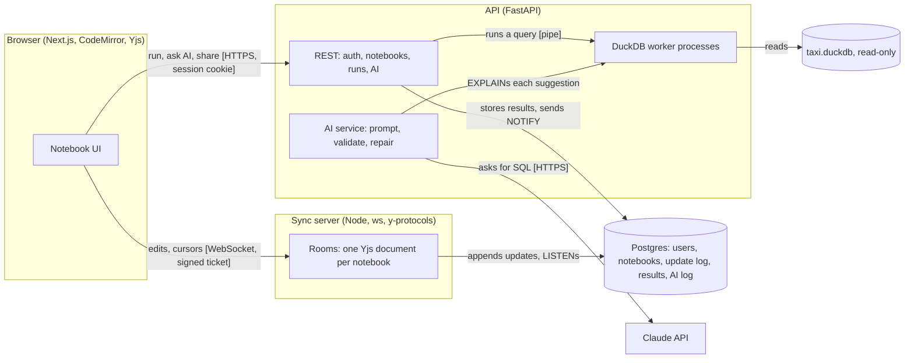

- **Web app** (`apps/web`): Next.js, with the CodeMirror editor bound to a Yjs document. It talks to the sync server for the notebook's content and to the API for everything else.
- **Sync server** (`apps/sync`): our own WebSocket server on the standard Yjs protocol. It checks a signed ticket and the person's access on connect, drops viewers' edits, saves every change to Postgres, and writes new results and AI suggestions into the notebook when the API announces them.
- **API** (`services/api`): FastAPI, for sign-in, notebooks, sharing, query runs and the AI. Queries run in a pool of DuckDB worker processes with a timeout, row and memory limits, and a hard kill.
- **AI service** (`services/api/src/notebook_api/ai`): builds the prompt from the schema and sample values, calls Claude, checks each query with EXPLAIN on a worker, repairs it up to twice if it fails, and logs every request.

**A keystroke:** the editor changes the cell's text in the browser's copy of the notebook. The change goes to the sync server, which relays it to everyone else in the notebook and saves it to Postgres. Each browser applies it to its own copy.

**A run:** the browser asks the API to run a cell. The API makes sure only one run of that cell happens at a time, runs the SQL on a worker, stores the result in Postgres and announces it. The sync server writes the new run into the notebook, and every open browser fetches and shows the result.

Why each part was built this way, and what each choice costs: [docs/design.md](docs/design.md).

## Results

Each number below is reproduced by the command next to it, and each run records its machine, commit and settings. The benchmarks ran on one Apple M4 laptop (10 cores, 16 GiB, macOS) with every client and server on that machine, at clean commit `4aa2756` on 2026-11-14 UTC. They are this machine's numbers, not a server's.

| Test | Result | Reproduce |
|---|---|---|
| Convergence under random concurrency | **0 differences between editors** in 50 seeds × 4,000 random edits. Each seed had 4 editors and 1 viewer, 176–225 connects, 1 page unload, 1 crash and 1 restart. In 2 of the 50 seeds, the viewer kept run or AI state that the crash had lost (a [known limitation](#limitations)) | `FUZZ_VERBOSE=1 FUZZ_SEED=1000 FUZZ_RUNS=50 pnpm --filter sync test fuzz` |
| Keystroke to the other browser's page, 2 browsers | **p50 3.6–3.8 ms, p95 5.0–5.4 ms** (range over 3 runs of 100 keystrokes each) | `pnpm bench:latency`, run 3 times |
| The same, with 20 more editors typing | p50 1.4–1.6 ms, p95 2.6–4.0 ms | the same runs |
| Editors in one notebook with p95 under 100 ms | **At least 50** (p95 4.0–5.2 ms at 50). At 100, p95 was 8,358–22,412 ms and the result is marked inconclusive: the load generator also fell behind, while the sync server used 95–99% of one core in the 2 runs where its CPU was measured | `pnpm bench:load`, run 3 times |
| Text-to-SQL, 50 taxi questions | **50/50 for each of Haiku 5.5, Sonnet 5.5 and Opus 5.5** (95% CI 92.9–100.0% each) | see below |
| Text-to-SQL, BIRD dev (500 questions) | Execution accuracy **Haiku 5.5 49.0%, Sonnet 5.5 52.4%, Opus 5.5 70.0%** | see below |
| Query safety | 157 adversarial queries through the real query path: 138 refused or kept within limits, and 19 harmless ones allowed | `pnpm test:api` (`test_query_adversarial.py`) |

<details>
<summary>Benchmark details</summary>

- **Latency** (`apps/bench/src/latency.ts`): two headless Chromium processes. The time runs from the keydown on one page to the first DOM change showing the character on the other, so it covers CodeMirror, Yjs, the provider, the sync server and the other page's editor. It doesn't include the paint after that, or real network distance. Both pages' clocks are corrected against one reference by round trips (correction at most 0.17 ms, with ±0.26 ms or less left over). Percentiles are nearest-rank over 100 keystrokes after 20 warm-up keystrokes, typed at 5 per second. In all 3 runs, latency was lower with the 20 extra editors than without them. We haven't investigated why.
- **Load** (`apps/bench/src/load.ts`): headless Yjs clients over real WebSockets. They aren't browsers. Steps of 2, 5, 10, 25, 50 and 100 editors, each typing 5 keystrokes per second in its own cell, measured for 20 s after a 5 s warm-up. Latency is from edit to applied on up to 8 observing clients on their own threads, with missing deliveries counted as infinitely late (there were none). p95 at each step, as the range over 3 runs: 1.8–1.9, 1.5–1.6, 1.7–2.0, 3.5–4.3, 4.0–5.2 ms. At 100 editors the clients sent 33,580–42,152 messages per second to the server, because every client re-sends each cursor change it receives (y-websocket does this, and so does the browser), so traffic grows with the square of the editors.
- Raw samples, summaries and reports for each run are written to `data/bench-results/`. They aren't in git; rerun the commands to regenerate them.

</details>

<details>
<summary>Text-to-SQL evaluation details</summary>

- **Scoring:** execution accuracy as BIRD scores it: the predicted and reference queries run on the same database, and the answer is right when the results are equal as sets of rows. Numbers are compared by value, so a DECIMAL 15.74 equals a DOUBLE 15.74. Intervals are 95% Wilson intervals.
- **Taxi suite:** the 50 questions in `services/api/evals/taxi_questions.toml` (20 simple, 20 moderate, 10 challenging), written with their reference queries by Codex (an OpenAI model). Before use, a separate Claude reviewer ran every reference query and checked that it answers its question. Every first answer was valid SQL and right, so the repair loop never ran. Cost, computed from list prices: Haiku $0.0173, Sonnet $0.1590, Opus $0.3828. Run at clean commit `e8eabec`, 2026-11-14 UTC. Rerun (paid; it asks for `--allow-spend`):
  ```
  pnpm eval -- run --suite taxi --models claude-haiku-5-5,claude-sonnet-5-5,claude-opus-5-5 --allow-spend
  ```
- **BIRD dev:** 500 of the 1,534 questions, sampled by difficulty with seed 20261113. Every model got the same questions, with BIRD's evidence hints, effort `medium` and no model fallback. Haiku and Sonnet aren't distinguishable at this size; Opus is clearly ahead. Every first answer was valid SQL, so the repair loop never ran here either, and this run can't show whether repair helps. Cost, computed from list prices including prompt caching: Haiku $0.1435, Sonnet $1.4586, Opus $3.0483. Run at commit `a588d71`, 2026-11-13. Rerun (paid):
  ```
  pnpm eval -- run --suite bird --size 500 --models claude-haiku-5-5,claude-sonnet-5-5,claude-opus-5-5 --allow-spend
  ```
- `pnpm eval -- report --run-id <id>` rebuilds a report from its stored answers for free. Model answers vary from run to run, so a fresh run can score differently.

</details>

## Testing and operations

### Run the tests

| Command | What it proves |
|---|---|
| `pnpm check` | Lint, type checks, and every unit and integration test: web, sync, benchmarks and API (needs Postgres running) |
| `pnpm e2e` | Real browsers against the real stack: editing together, runs, the AI flow (stand-in model), sharing, viewers, offline editing, and the journeys of someone who has never written SQL. Run `pnpm --filter web exec playwright install chromium` once first |
| `pnpm test:api:linux` | The API tests in a Linux container, including the operating system's memory cap on query workers |
| `FUZZ_RUNS=40 pnpm --filter sync test fuzz` | The convergence fuzz test at more seeds (`pnpm check` runs 4) |

The fuzz test's rule: after any mix of concurrent edits, delivery orders, dropped messages, offline edits, reconnects, failed saves, a page unload, a crash and a restart, every editor, the server's copy and a fresh load from Postgres are identical, and no viewer's edit appears anywhere.

GitHub Actions runs `pnpm check` (on Linux, so the API's Linux-only tests run too) and `pnpm e2e` on every push and pull request to `main`. No API keys are needed, so the tests never cost money.

### Run the benchmarks

The latency benchmark needs Chromium, installed once with `pnpm --filter web exec playwright install chromium`. It types in one browser and times the keystroke's arrival in another. The load test runs 2 to 100 editors in one notebook.

```sh
pnpm bench:latency
pnpm bench:load
```

Each benchmark starts its own servers on their own ports and its own test database, with the stand-in AI model, and writes a report to `data/bench-results/`.

### Run the text-to-SQL evaluation

The first command runs the whole harness with a fake model and spends nothing (it downloads BIRD dev first). The second is a real, paid run of the taxi questions on Haiku, and needs `ANTHROPIC_API_KEY`.

```sh
pnpm eval -- run --dry-run --limit 5
pnpm eval -- run --suite taxi --models claude-haiku-5-5 --allow-spend
```

Paid runs refuse to start without `--allow-spend`. A run can be resumed with `--run-id`, and each report lists the exact commands to resume it or run it again.

## Troubleshooting

**`Bind for 127.0.0.1:5432 failed: port is already allocated`**
Another Postgres is using port 5432. Stop it, or set `POSTGRES_PORT` in `.env` to a free port and change the port in `DATABASE_URL` to match.

**The API won't start: `AUTH_SECRET must be at least 32 characters`** (or the same for `SYNC_TICKET_SECRET`)
Fill both in `.env` with `openssl rand -hex 32`. They must be different: otherwise the API stops with `SYNC_TICKET_SECRET must differ from AUTH_SECRET`.

**Signing in says "Sign-in is not configured."**
`AUTH_SECRET` is empty. Set it in `.env` with `openssl rand -hex 32` and restart `pnpm dev:api`.

**The API won't start: `DuckDB database not found: … (run pnpm ingest)`**
Run `pnpm ingest` to download the taxi data and build `data/taxi.duckdb`.

**Asking the AI says "The AI assistant is not configured."**
Set `ANTHROPIC_API_KEY` in `.env`, or `AI_FAKE_MODEL=true` to try it with canned answers, then restart `pnpm dev:api`.

**The notebook says "Live collaboration is not configured."**
`SYNC_TICKET_SECRET` is empty. Set it in `.env` (the API and the sync server read the same value) and restart both.

**Signed in, but the app acts as if you weren't**
Open the app at `http://localhost:3000`, not `127.0.0.1`. The browser treats them as different sites, so the sign-in cookie set for one isn't sent to the other.

**`pnpm e2e` or `pnpm bench:latency` can't find a browser**
Run `pnpm --filter web exec playwright install chromium` once.

## FAQ

**Do I need to know SQL?**
No. Ask in plain English and use **Accept and run**. The query is there to read if you're curious, and **Explain this query** explains any query in plain words.

**Can the AI change my notebook on its own?**
No. Its suggestions appear for everyone in the notebook, marked as the AI's. Nothing it writes goes into a cell until a person accepts it.

**Can a query break the data or read my files?**
No query can change the data: the database is opened read-only and only SELECT is allowed. File and network access are turned off, a block list stops functions that reveal server details, and long queries are killed. The protections are tested against 157 adversarial queries. There's no operating-system sandbox around the workers, though: see [Limitations](#limitations).

**What does it cost to run?**
Running it locally is free. With a real API key, each question costs what Anthropic charges for the model you choose. For a sense of scale, Haiku answered all 50 taxi questions for $0.0173 in total, computed from list prices.

**Does it work offline?**
Editing does. Your edits are kept and merge with everyone else's when the connection is back. Running queries and asking the AI go through the server.

**Can I use my own data?**
Not without changing code. The schema description, the data guide, the AI's prompt and the ingest step are all written for the taxi dataset.

**Is there a hosted version?**
Not yet. It runs locally only.

## Limitations

- **Not deployed.** Running the web app and the API on separate domains will need both under one registrable domain, so the sign-in cookie works.
- **One process each** for the sync server and for the API's in-memory rate limits. Running more copies needs routing by notebook.
- **No operating-system sandbox** for query workers. Safety comes from DuckDB's lockdown settings, a block list and process limits, tested against an attack corpus. On macOS, runaway memory is stopped only by the timeout kill.
- **A crash in the 250 ms before a save** can lose server-written run or AI state for viewers until they reload, and edits that were confirmed but not yet saved.
- **The connection ticket travels in the WebSocket URL** (reusable for 60 s), and signing out doesn't yet close open connections.
- **The AI log keeps each notebook's 500 most recent requests,** not every request ever made.
- **Cursor traffic grows with the square of the editors:** every y-websocket client, the browser included, re-sends each cursor change it receives. At 100 editors the sync server used 95–99% of one core (in the 2 of 3 runs that measured it). How much of that is cursor traffic hasn't been measured separately.
- **The taxi evaluation can't tell the models apart,** because its questions are worded precisely. How the assistant handles vague questions isn't measured.

**When not to use Taxi Notebook:**

- You need your own data. It only knows the taxi dataset.
- You need it hosted for a team today. It only runs locally so far.
- You need dozens of people editing one notebook at once on modest hardware. That was measured up to 50 editors on one laptop.

More, with the trade-offs, in [docs/design.md](docs/design.md#known-limitations).

## Project structure

```
apps/web/        Next.js notebook (CodeMirror, Yjs, charts)
apps/sync/       WebSocket sync server and the convergence fuzz test
apps/bench/      latency benchmark and load test
services/api/    FastAPI: auth, notebooks, query workers, AI, evaluation harness
  evals/         the 50 taxi questions
data/            taxi.duckdb, BIRD, evaluation and benchmark results (not in git)
docs/            design decisions, images
```

## Data and credits

- Trip data: [NYC Taxi and Limousine Commission trip records](https://www.nyc.gov/site/tlc/about/tlc-trip-record-data.page), yellow taxis, January to March 2024, plus the taxi zone lookup. Files are pinned by SHA-256 in `services/api/src/notebook_api/dataset/manifest.py`.
- Text-to-SQL benchmark: [BIRD](https://bird-bench.github.io/) dev set (Li et al., 2023), downloaded and checksum-verified by the evaluation harness.
- The 50 taxi questions were written by Codex (an OpenAI model) at the project owner's request, so the Claude models aren't scored on questions Claude wrote.

## Contributing and support

Questions and bug reports: [open an issue](https://github.com/KaavinB/collab-sql-notebook/issues). Pull requests are welcome. Before opening one, run `pnpm check` and `pnpm e2e`. If you change the AI's prompt, include an evaluation run showing its effect.

## License

[MIT](LICENSE) © 2026 Kaavin
